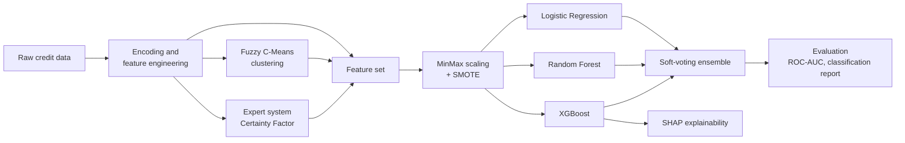

# UBMager: Hybrid Credit Default Risk Model

> Predicting loan default risk by combining an **expert system**, **fuzzy logic** and a **machine learning ensemble**. Built for a datathon competition.


[](https://colab.research.google.com/github/athaaaya/Datathon_UBMager/blob/main/notebooks/ubmager_credit_risk.ipynb)

---

## Overview

Lenders need to know which applicants are likely to default before approving a loan. A pure black-box model can be accurate but hard to justify to credit analysts, while a rule-based system is easy to explain but too rigid.

**UBMager** combines the two. Domain rules and fuzzy clustering produce interpretable risk signals, and those signals feed an ensemble of machine learning models. SHAP values then explain which factors drive each prediction.

### Highlights

- **Expert system (Certainty Factor).** Encodes credit-analyst rules, such as low income combined with short employment, or a prior default without fixed assets, into combined confidence scores for *default* and *non-default*.
- **Fuzzy C-Means clustering.** Groups applicants into soft segments by age, income and employment length, so borderline applicants are not forced into a hard category.
- **Feature engineering.** Adds `stable_job`, `has_fixed_asset` and `loan_to_income_ratio`.
- **Class imbalance handling** with SMOTE oversampling.
- **Model ensemble.** XGBoost, Random Forest and Logistic Regression, combined in a soft-voting classifier.
- **Explainability.** SHAP feature-importance analysis on the XGBoost model.
- **Deployable artifact.** The final ensemble is exported as `ubmager_model.pkl` via `joblib`.

## Pipeline



## Tech Stack

| Area | Tools |
|---|---|
| Data processing | pandas, NumPy |
| Machine learning | scikit-learn, XGBoost, imbalanced-learn (SMOTE) |
| Soft computing | Certainty Factor expert system, Fuzzy C-Means (`fuzzy-c-means`) |
| Explainability | SHAP |
| Visualization | Matplotlib |
| Environment | Jupyter / Google Colab |

## Repository Structure

```
Datathon_UBMager/
├── notebooks/
│   └── ubmager_credit_risk.ipynb   # Step-by-step notebook with explanations and results
├── src/
│   └── ubmager_pipeline.py         # The full pipeline as a single runnable script
├── requirements.txt
├── LICENSE
└── README.md
```

## Dataset

The pipeline expects `credit_risk_dataset.csv`, the public credit risk dataset available on Kaggle. It includes columns such as `person_age`, `person_income`, `person_emp_length`, `person_home_ownership`, `loan_percent_income`, `cb_person_default_on_file` and the target `loan_status`.

The dataset is not included in this repository. Download it and place it in the working directory before running.

## Getting Started

### Option 1: Google Colab (fastest)

1. Click the **Open in Colab** badge above.
2. Upload `credit_risk_dataset.csv` to the Colab session.
3. Run the install cell, restart the session, then run all cells.

### Option 2: Local

```bash
git clone https://github.com/athaaaya/Datathon_UBMager.git
cd Datathon_UBMager
python -m venv .venv
source .venv/bin/activate        # Windows: .venv\Scripts\activate
pip install -r requirements.txt
python src/ubmager_pipeline.py
```

The script prints a classification report and ROC-AUC for each model, shows a SHAP feature-importance chart, and saves the trained ensemble to `ubmager_model.pkl`.

## Key Insights

Based on the expert rules and model analysis:

| Higher default risk | Lower default risk |
|---|---|
| Low income | High income |
| Age under 25 | Age over 30 |
| Under 1 year at current job | 5+ years at current job |
| No home ownership | Owns a home (fixed asset) |
| Prior default on file | Clean credit history |
| High loan-to-income ratio (> 60%) | Low loan-to-income ratio (< 30%) |

## Future Improvements

- Apply SMOTE **only to the training split** (after `train_test_split`) so that test metrics reflect real-world class balance.
- Tune hyperparameters with cross-validated search.
- Calibrate the certainty-factor rule thresholds against the data.
- Serve the saved model through a simple API or Streamlit demo.

## License

Released under the [MIT License](LICENSE).

## Author

**Athaya Akbar**: [GitHub @athaaaya](https://github.com/athaaaya)
